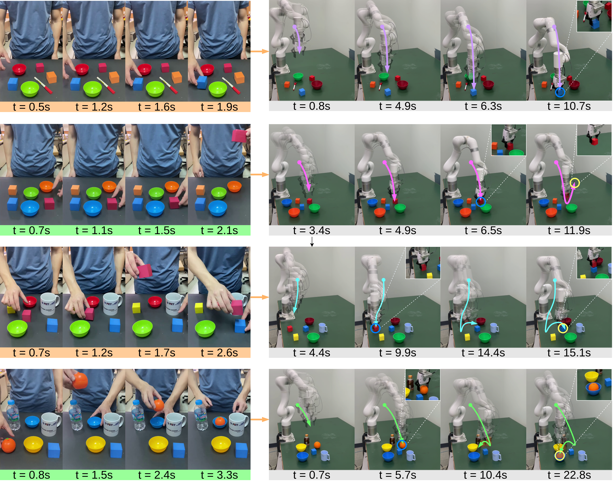
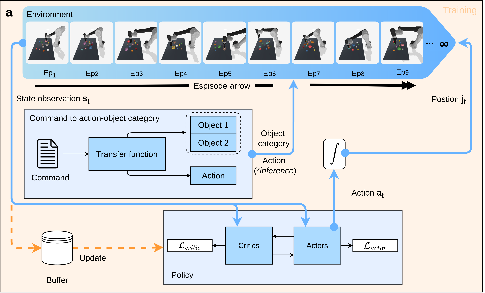
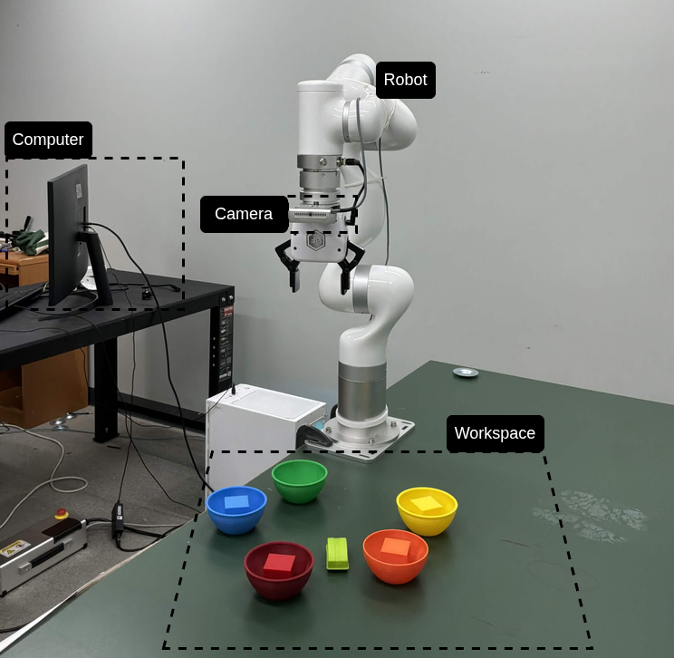

# Learning to Manipulate by Watching Humans: Decoupling Video-to-Task-Command Parsing from Reinforcement-Learned Skill Execution

**Authors:** [Thanh Nguyen Canh](https://thanhnguyencanh.github.io/), [Thanh Tuan Tran](https://pairs-lab.github.io/people/tuan-thanh-tran/), Haolan Zhang, Ziyan Gao, [Xiem HoangVan](https://sites.google.com/site/xiemhoang/), [Nak Young Chong](https://www.jaist.ac.jp/robot/).

LfD4hri separates video understanding from robot skill execution: human video
demonstrations are converted into task commands, which are executed by learned
manipulation policies. The repository includes **UR5e simulation experiments**,
**UF850 simulation-to-real deployment**, and **VLA comparison baselines**.

<p align="center">
  
</p>

## Project structure

```text
LfD4hri/
├── DRL/
│   ├── asset/                   Robot/object assets and XML parameters
│   ├── env/                     PyBullet RL training environment
│   ├── env_eval/                Simulation evaluation and recording utilities
│   ├── models/                  TD3 and other RL implementations
│   ├── reward/                  Task rewards and termination logic
│   ├── utils/                   Simulation, camera and normalization utilities
│   ├── train_td3.py             TD3 skill-policy training
│   ├── eval.py                  Saved-policy evaluation in simulation
│   └── VLA_baselines/           Source-only VLA adapters, recipes and tests
├── deploy/                     Real UF850 evaluation, hardware and camera code
├── figures/                    README figures
├── LLaVA/                      Vision-language components
├── Video_keyframe_detector/    Video keyframe extraction
├── mmaction2/                  TSM action-recognition backend (default)
├── MVD_S/                      Optional native MVD-S backend
├── utils/                      Video-processing utilities
├── requirements.txt
└── demo.py                     Video-understanding entry point
```

## Installation

```bash
conda create --name lfd4hri python=3.11
conda activate lfd4hri
cd LfD4hri
pip install -r requirements.txt
```

Run each component from its own directory as shown below. VLA models and real
hardware require additional, component-specific dependencies.

## Video understanding

Choose an action-recognition backend for [`demo.py`](demo.py):

- **TSM (default):** `--action_backend tsm`. Place the
  [checkpoint](https://drive.google.com/file/d/1oZpapQmfzchaC9-GR4uIrawlye-kXaVf/view?usp=drive_link)
  in `mmaction2/pretrained_file_and_checkpoint/`.
- **MVD-S (optional):** `--action_backend mvd_s --mvd_checkpoint /path/to/checkpoint.pth`.
  [`MVD_S/README.md`](MVD_S/README.md) covers dependencies, compatible checkpoints,
  standalone inference and supervised fine-tuning; trained weights are not included.

Both use the [hand-detection checkpoint](https://drive.google.com/open?id=1H2tWsZkS7tDF8q1-jdjx6V9XrK25EDbE)
in `video_understanding_checkpoint/res101_handobj_100K/pascal_voc/`.
Create missing directories and configure the demo's input/checkpoint arguments.

## Reinforcement-learning skills

- **UR5e (`ur5e`):** simulation experiments and comparisons in the paper.
- **UF850 (`uf850`):** simulation training for transfer to the physical UF850.

Both use four task IDs: **0: Touch/Reach, 1: Pick, 2: Move, 3: Put**.
Robot parameters are in `DRL/asset/params/{ur5e,uf850}_suction.xml`;
reward thresholds (`threshold0`, `threshold1`) are in
[`DRL/asset/params/reward.xml`](DRL/asset/params/reward.xml).

<p align="center">
  
</p>

**Before running:** match the robot initialization in
[`env/robot_env.py`](DRL/env/robot_env.py) and
[`env_eval/robot_env.py`](DRL/env_eval/robot_env.py) to the checkpoint: URDF,
home pose, tool link and limits. Current defaults are UF850; training's
`--robot` does not update all constructor settings, and evaluation has no
`--robot` flag.

```bash
cd DRL
# Alternative training examples; configure the selected robot first.
python train_td3.py --action 0 --robot ur5e --policy_name td3_ur5e
python train_td3.py --action 0 --robot uf850 --policy_name td3_uf850

# Evaluate the UR5e policy after configuring the evaluation environment for UR5e.
python eval.py --action 0 --policy_name td3_ur5e --max_episode 200
```

Change `--action` for other skills. Evaluation requires an existing
`DRL/<policy_name>_<action>/ckpt/best` and restores its normalization statistics;
a missing checkpoint does not raise an error. **Use a unique policy name per
robot/run:** training resets its log/video directories and may overwrite weights.

## VLA baselines

[`DRL/VLA_baselines/`](DRL/VLA_baselines/README.md) contains source code for
**FLOWER, X-VLA, π₀, VLA-Adapter, SmolVLA, VLA-JEPA, Dita, VLANeXt-S,
FALCON-ESM and Seer**. The package includes:

- Shared PyBullet environments and model-specific observation/action adapters.
- Demonstration loading, normalization, fine-tuning/recovery recipes and evaluation.
- Regression tests, source verification and pinned upstream source references.

See [setup and commands](DRL/VLA_baselines/README.md),
[model entry points](DRL/VLA_baselines/MODELS.json) and
[upstream revisions](DRL/VLA_baselines/UPSTREAMS.json). Supply weights and datasets
separately, use each model's dependencies, and configure historical machine-specific
paths. Match camera/state inputs, action conventions and the shared executor to the
selected checkpoint. Historical runners retain their original observations;
the separate `protocol21/` contract is **not yet integrated into every runner**.
No weights, datasets, experiment outputs or installed environments are bundled.

## UF850 real-robot deployment

[`deploy/`](deploy/) contains the UF850 hardware interface, camera/calibration
utilities and [`eval.py`](deploy/eval.py) for trained TD3 skills. Install the
xArm Python SDK (`xarm.wrapper`) and camera drivers. Configure
[`deploy/utils/robot.conf`](deploy/utils/robot.conf), camera calibration and
the target/workspace in [`deploy/env_eval/robot_env.py`](deploy/env_eval/robot_env.py).
Use a UF850 checkpoint with its normalizer and matching joint/tool conventions.

<p align="center">
  
</p>

After hardware configuration and safety checks, a single Touch episode uses:

```bash
cd deploy
# Supply deploy/td3_uf850_0/ckpt/best from the matching simulation run first.
python eval.py --action 0 --policy_name td3_uf850 --max_episode 1
```

**This command controls the physical robot.** Check workspace clearance,
motion limits, suction and emergency stop before running. It deploys UF850 RL
policies, not the VLA baselines.

## Citation

If you use this work, please cite:

```bibtex
@article{canh2026human,
  title={Learning to Manipulate by Watching Humans: Decoupling Video-to-Task-Command Parsing from Reinforcement-Learned Skill Execution},
  author={Thanh Nguyen Canh and Thanh Tuan Tran and Haolan Zhang and Ziyan Gao and Xiem HoangVan and Nak Young Chong},
  journal={},
  year={2026}
}
```
